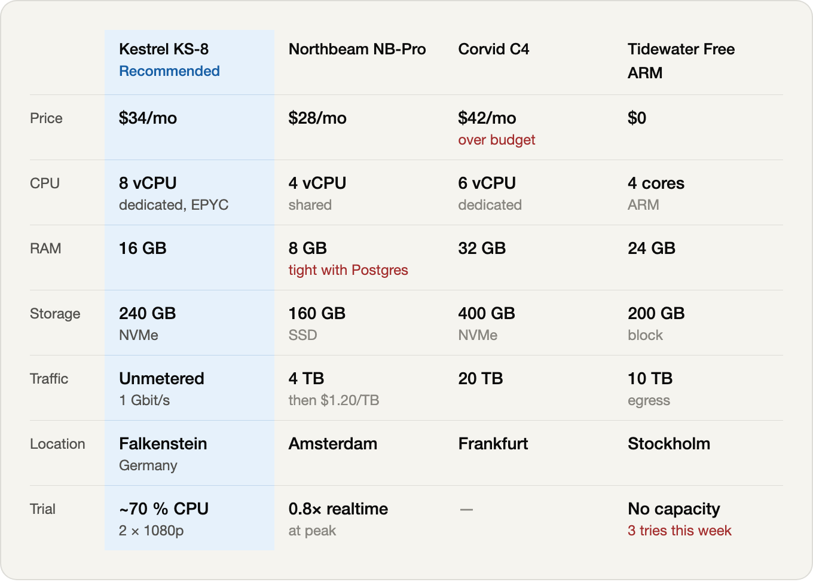
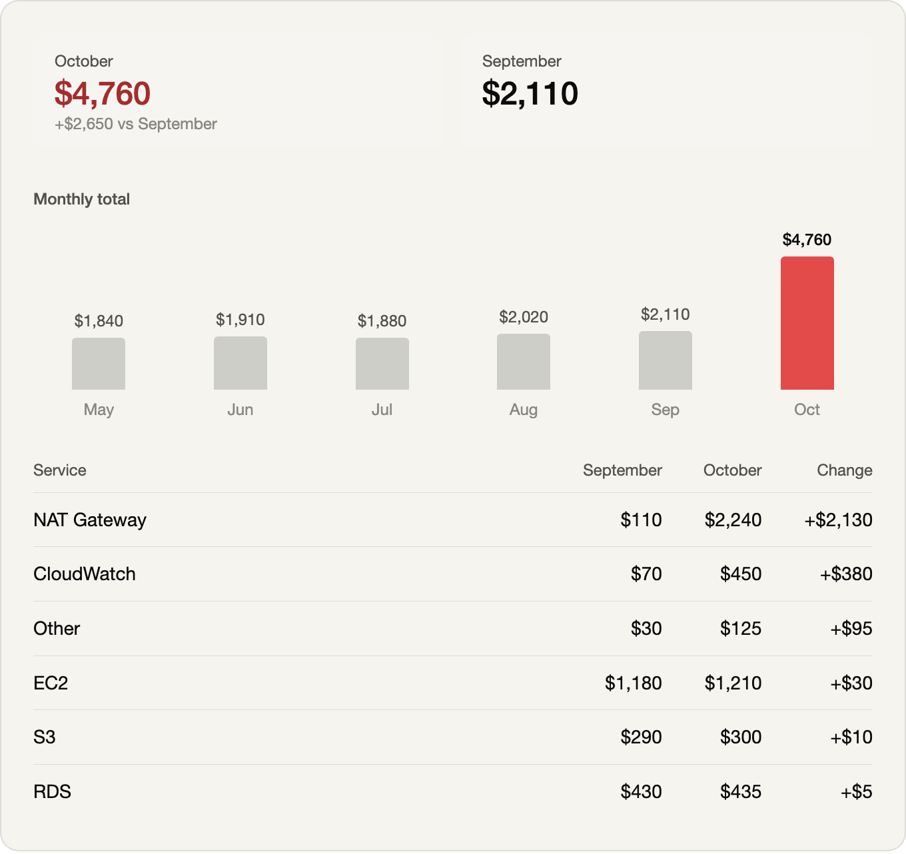
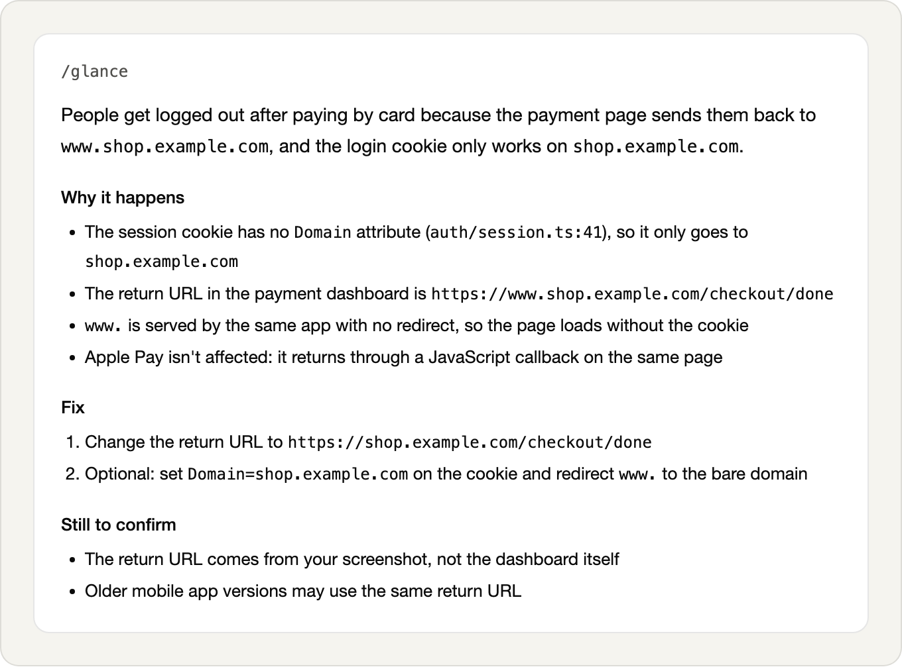
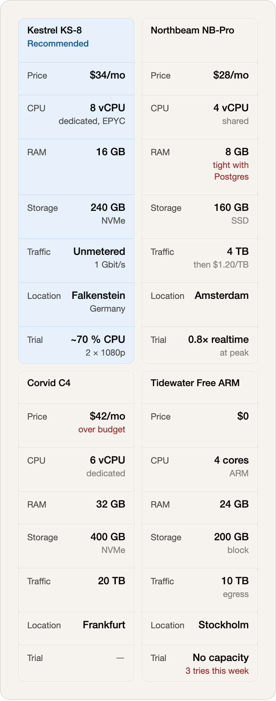

<picture>
  <source media="(prefers-color-scheme: dark)" srcset="docs/images/hero-dark.png">
  
</picture>

# glance

A Claude Code skill that rewrites Claude's last answer so you can read it at a glance. It opens with the answer in plain words, shows the data as a table or chart when there is data, and puts the rest in short bullets. Every number, name, path, command, warning and open question from the original stays in.

## Install

```bash
git clone https://github.com/haslanli/glance-skill ~/.claude/skills/glance
```

Claude Code notices new skills while it runs, so there's no restart. If `~/.claude/skills` didn't exist before, run `/reload-skills` once.

To update later:

```bash
git -C ~/.claude/skills/glance pull
```

## Use

After a long answer, type:

```
/glance
```

To keep it out of the main conversation, ask it as a side question:

```
/btw /glance
```

| Command | What it does |
|---|---|
| `/glance` | Re-tells the last answer once |
| `/glance <what>` | Re-tells one answer or part of one: `your reply about the build`, `only the numbers`, or pasted text |
| `/glance on` | Re-tells the last answer, then answers this way until you turn it off |
| `/glance super` | Same as `on`, with every bullet cut to a short fragment |
| `/glance off` | Back to normal replies |
| `/glance status` | Says which mode is on |
| `/glance help` | Shows this list |

Modes set inside `/btw` stay there. A side question doesn't change the main conversation.

## It decides when to draw

glance looks at the answer before it draws anything. If there's data to compare, it picks the picture that fits the data. If there isn't, it doesn't draw one.

| The answer has | glance shows |
|---|---|
| 2 to 4 key figures | Headline numbers |
| One series over time | Columns with the values on them |
| A few numbers for each item, like before and after | An aligned table where only the rows that got worse turn red |
| Several options with the same specs | A comparison with the recommended option filled in |
| Mostly reasoning | No picture, just the answer and bullets |

Every result has the same three parts: the answer in one or two plain sentences, the picture if one helps, and short bullets for the rest.

### Comparing options

<picture>
  <source media="(prefers-color-scheme: dark)" srcset="docs/images/vps-dark.png">
  
</picture>

### A change over time

<picture>
  <source media="(prefers-color-scheme: dark)" srcset="docs/images/bill-dark.png">
  
</picture>

### Nothing to compare

A bug explanation is all reasoning, so there's no picture. Paths, URLs and settings stay word for word.

<picture>
  <source media="(prefers-color-scheme: dark)" srcset="docs/images/text-only-dark.png">
  
</picture>

### Narrow panels

In a narrow side panel, comparisons turn into cards instead of squeezing columns.

<picture>
  <source media="(prefers-color-scheme: dark)" srcset="docs/images/vps-narrow-dark.png">
  
</picture>

## Rules it follows

- Keeps every number, name, path, command, step, warning and open question.
- Adds nothing the original didn't say. A value it doesn't have is shown as `—`.
- Aims for about a third of the original's length and is never longer.
- Keeps commands, code and error messages word for word.
- Uses red only for what got worse or fails, and one accent color for the recommended option.

## Where pictures show up

Charts and tables are drawn with the visualize tool in the Claude desktop app, including `/btw` side chats there. Where that tool isn't available, for example `/btw` in a terminal, glance falls back to markdown tables.

## What's in this repo

| Path | Contents |
|---|---|
| `SKILL.md` | The instructions Claude follows |
| `references/ui-kit.md` | The CSS and components every picture is built from |
| `evals/` | Four test reports with pass/fail checks: a cloud bill, a server choice and a site speed pass that should get pictures, and a bug explanation that shouldn't |
| `tools/` | Scripts that check numbers and length, and the preview tool that made these screenshots |

The tests use the folder format that `claude plugin eval` reads:

```bash
claude plugin eval . --allow-tools Write,Edit,Bash --scaffold
```

## Credits

glance started from [tldr](https://github.com/generativelabs/g-genlabs-skill-tldr) by [Generative Labs](https://www.generativelabs.com). Pointing at an earlier answer, the on/super/off modes, and the rule to cut wording but keep every fact all come from tldr. glance adds the plain-language first line, the charts and tables, and the UI kit. If you only want bullet summaries, tldr does that well.

## License

MIT. See [LICENSE](LICENSE).
