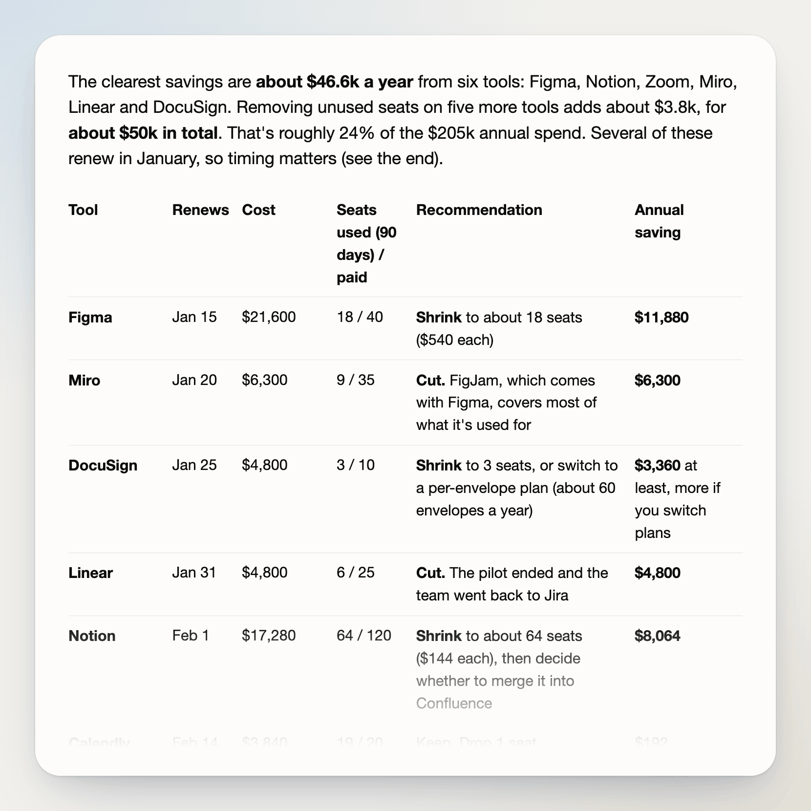
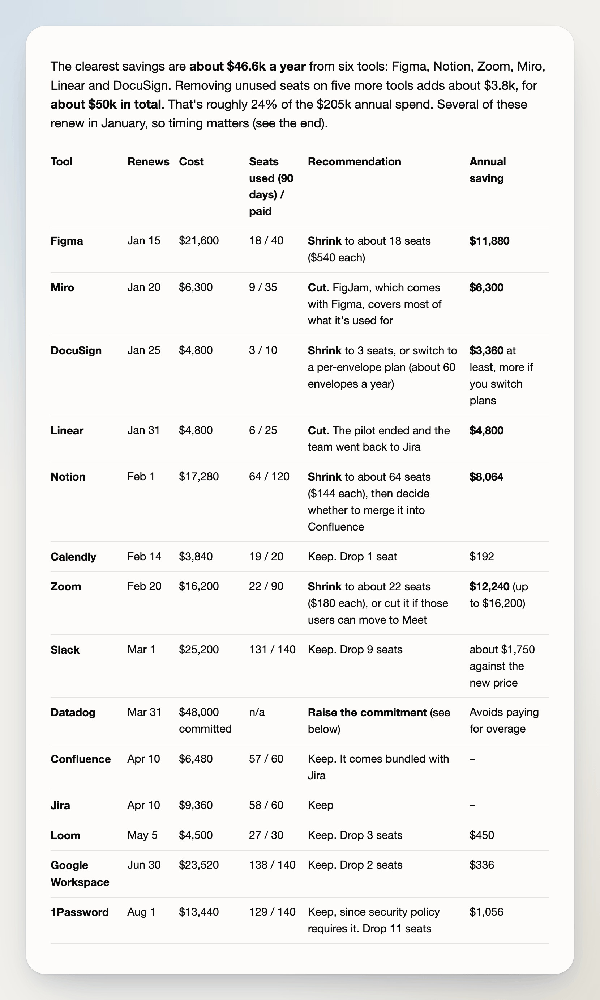
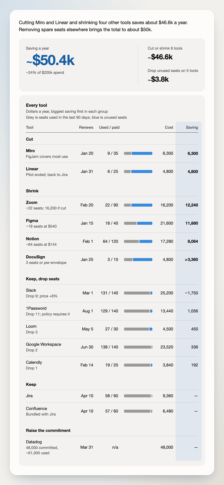
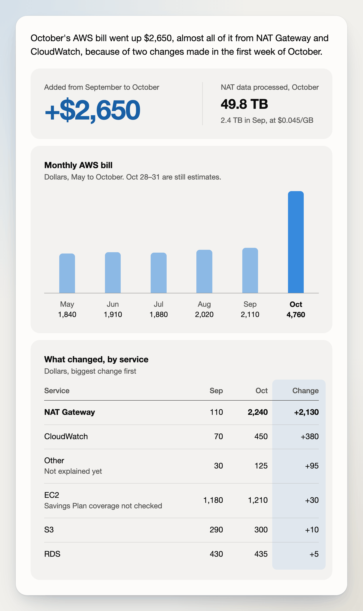
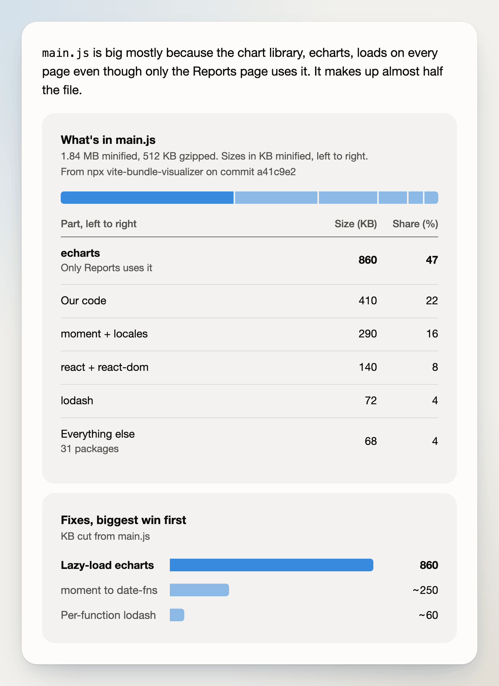

<picture>
  <source media="(prefers-color-scheme: dark)" srcset="docs/images/hero-dark.png">
  
</picture>

# glance

**Claude's long answers, readable at a glance.**

### [Live demo →](https://haslanli.github.io/glance-skill/)

Every picture on the site is live: sort and filter the tables, drag to compare with the original answer, and hover any number to see the line it came from.

glance is a skill for Claude Code. Type `/glance` after a long answer, and Claude tells it again for someone short on time or background. You get the answer in one plain sentence, a picture when the answer has data, and a few short bullets for the rest. It's built to keep every number, name, path, command, warning and open question, and to add nothing. So it cuts wording, not facts: on real answers the text comes out about half to two-thirds as long, and a table keeps its size, because every value stays. In the Claude desktop app the picture is drawn right in the chat; in a terminal it becomes a markdown table.

**Contents:** [Live demo](https://haslanli.github.io/glance-skill/) · [Install](#install) · [Big tables](#big-tables) · [Examples](#examples): [bills](#bills), [test results](#test-results), [performance](#performance), [progress](#progress) · [Commands](#commands) · [Why not dataviz?](#why-not-just-use-dataviz) · [Readable by everyone](#readable-by-everyone) · [New in v3](#new-in-v3)

## Install

```bash
git clone https://github.com/haslanli/glance-skill ~/.claude/skills/glance
```

Claude Code picks up new skills while it runs, so there's no restart. If `~/.claude/skills` didn't exist before, run `/reload-skills` once. To update later, run `git -C ~/.claude/skills/glance pull`.

## Big tables

A wide table is where a plain answer reads worst. Claude writes it as markdown, the chat lays it out at the width of its column, and every column with a long cell takes the room: short columns shrink to stacks of wrapped words, rows grow four lines tall, and the rows that matter look like all the others. glance rebuilds the same table: the same 14 tools and the same numbers, one line per row, grouped by what to do and sorted by what you'd save, with a bar of used and unused seats on every row and the long advice moved into short notes under each name and the bullets.

**Stock Claude:** 622 words, with a 14-row, 6-column table of renewals and three sections after it. Its table as the chat lays it out:

<picture>
  <source media="(prefers-color-scheme: dark)" srcset="docs/images/table-stock-dark.png">
  
</picture>

<details><summary>The whole table</summary>

<picture>
  <source media="(prefers-color-scheme: dark)" srcset="docs/images/table-stock-full-dark.png">
  
</picture>

</details>

**glance, on the same answer:**

<picture>
  <source media="(prefers-color-scheme: dark)" srcset="docs/images/table-glance-dark.png">
  
</picture>

<details><summary>The whole picture</summary>

<picture>
  <source media="(prefers-color-scheme: dark)" srcset="docs/images/table-glance-full-dark.png">
  
</picture>

</details>

<sub>A SaaS renewal review for a made-up 140-person company, answered by stock Claude (Opus 5.5), then re-told with `/glance`. Both pictures are the same width; the stock table is drawn by the browser's own table layout, the way a chat column draws markdown. glance's reply text: 219 words, from 622.</sub>

## Examples

Each picture is glance's own reply to a sample answer, drawn with the current kit and cropped to the sentence and the picture. The bullets that follow it in the chat are left out. Above each one is what the original answer looked like. When an answer is mostly reasoning, glance draws nothing and keeps it to a sentence and bullets.

### Bills

#### Why a bill jumped

**Before:** 276 words: the monthly totals in one line, a six-row table by service, what happened, four fixes and three caveats.

<picture>
  <source media="(prefers-color-scheme: dark)" srcset="docs/images/bill-jump-dark.png">
  
</picture>

<sub>An AWS bill that more than doubled. glance picked the increase as a headline figure, columns for six months of totals, then a table by service with each change in a tinted column.</sub>

<details><summary>The whole picture</summary>

<picture>
  <source media="(prefers-color-scheme: dark)" srcset="docs/images/bill-jump-full-dark.png">
  
</picture>

</details>

#### Teams against their budgets

**Before:** 152 words: a table of five teams' Q2 spend, Q3 spend and Q3 budget, why two teams went over, and what happens next.

<picture>
  <source media="(prefers-color-scheme: dark)" srcset="docs/images/bill-budget-dark.png">
  
</picture>

<sub>Quarterly cloud spend by team. glance picked the total as a headline figure, then a gauge per team with every budget at the same place, so the two teams over budget stand out.</sub>

#### Money spent on nothing

**Before:** 111 words: a table of 11 idle resources in three groups with counts and monthly cost, then the status of each group.

<picture>
  <source media="(prefers-color-scheme: dark)" srcset="docs/images/bill-idle-dark.png">
  
</picture>

<sub>Idle cloud resources. glance picked the total as a headline figure, then a table of causes: every resource under its cause, the count, the next step and the monthly cost.</sub>

### Test results

#### A nightly run in four browsers

**Before:** 479 words: a 24-row table of every spec in Chrome, Firefox, Safari and Edge, then each of the 5 failures and 3 flaky specs explained, and four fixes.

<picture>
  <source media="(prefers-color-scheme: dark)" srcset="docs/images/tests-grid-dark.png">
  
</picture>

<sub>An end-to-end test run, 24 specs × 4 browsers. glance picked headline numbers and a status grid you can filter, problem specs first and the one real bug named under its spec.</sub>

<details>
<summary>See all 24 specs</summary>

<picture>
  <source media="(prefers-color-scheme: dark)" srcset="docs/images/tests-grid-full-dark.png">
  
</picture>

</details>

### Performance

#### Latency after an upgrade

**Before:** 367 words: the nine endpoints that miss the target listed in a sentence, how it was measured, a 40-row table of every endpoint's p95 before and after the Go 1.23 upgrade, and two caveats.

<picture>
  <source media="(prefers-color-scheme: dark)" srcset="docs/images/perf-endpoints-dark.png">
  
</picture>

<sub>p95 latency for 40 endpoints. glance picked a headline count and a table you can sort, filter and search, with a gauge for each endpoint against the 300 ms target.</sub>

<details>
<summary>See all 40 endpoints</summary>

<picture>
  <source media="(prefers-color-scheme: dark)" srcset="docs/images/perf-endpoints-full-dark.png">
  
</picture>

</details>

#### What a bundle is made of

**Before:** 183 words: what's in `main.js` as a six-row table, three fixes with their savings, and three things to watch out for.

<picture>
  <source media="(prefers-color-scheme: dark)" srcset="docs/images/perf-bundle-dark.png">
  
</picture>

<sub>A JavaScript bundle that's too big. glance picked a split bar and a table of what it's made of, then the fixes as bars, biggest win first.</sub>

<details><summary>The whole picture</summary>

<picture>
  <source media="(prefers-color-scheme: dark)" srcset="docs/images/perf-bundle-full-dark.png">
  
</picture>

</details>

### Progress

#### A day of work, recapped

**Before:** four answers in one session, 526 words: a first measurement against the budget, two rounds of fixes with new numbers, then what's left and the plan for Monday.

<picture>
  <source media="(prefers-color-scheme: dark)" srcset="docs/images/progress-session-dark.png">
  
</picture>

<sub>A day of performance work, recapped with `/glance everything we did today`. glance picked one row per metric with the start, step 1 and now, and a gauge against its budget.</sub>

## Why not just use dataviz?

Claude Code's built-in dataviz skill teaches Claude how to draw a good chart: which form to pick, how to color it and how heavy the marks should be. It's very good at that, and glance follows its rules. But the two skills do different jobs.

- **dataviz draws the chart you ask for. glance re-tells an answer you already have.** It decides whether anything in the answer is worth a picture, which part that is and which form shows it best. Then it rewrites the words around it.
- **glance promises to keep every fact and invent nothing.** Every number, name, path, command, warning and open question stays in. It adds no trend lines, averages or projections, shows a missing value as `—`, and keeps commands and error messages word for word.
- **It's made to be read at a glance.** The answer comes first, in one plain sentence. The picture comes next, then a few bullets. You have the point before you read a single axis.
- **It only draws when there's data.** Reasoning stays as words, so you never get a chart for the sake of a chart.
- **Every picture comes from one tested kit.** The same components every time, checked in light mode, dark mode and narrow side panels. The tenth picture looks as considered as the first.
- **It builds on dataviz instead of replacing it.** glance's thin marks, one-axis rule and color checks come straight from dataviz's rules and its palette validator.

Use dataviz when you want Claude to make a chart. Use glance when Claude has already answered and you want to understand it fast.

## Readable by everyone

About one man in twelve can't easily tell red from green. Most charts lean on exactly that pair, so glance is built to work without it.

<picture>
  <source media="(prefers-color-scheme: dark)" srcset="docs/images/color-dark.png">
  
</picture>

- **Blue says look here, red says negative.** Ordinary marks are a soft blue, and what the answer is about is blue, even when it's bad news. Red appears only on a value past a limit, target or budget, or on something failing: that number, the part of its gauge past the line, and, when the answer says by how much, a short line under its name such as "8,900 over". Never a whole row of red text.
- **Red never sits against green.** There's no green at all: an improvement stays soft blue. Blue and red stay far apart for everyone.
- **There is no amber warning color.** v2 tried one for "tight" meters, and the color validator rejected it. Under red-green color blindness, amber and the alert red differ by only 3.2, where 8 is the minimum. Even with full color vision they score 12.7, below the floor of 15. So "tight" and "close" are words, and the bar stays soft blue.
- **Nothing depends on color alone.** A value past a line also runs past the tick on its gauge, a failing cell says "fail", the subtitle says what the tick and the red mean, and the recommended option is the large tile. Color helps you find it; the shape and the word tell you what it means.
- **Every value is printed** on the picture, so nothing hides behind a hover. The two exceptions are the points of a long line chart and the middle months of an inline trend, which show on hover and are read out to screen readers.
- **Each picture opens with a one-sentence summary** for screen readers. Its colors come from the app's theme, so light and dark mode both work. In narrow side panels, wide rows fold into two aligned lines and comparisons stack into one column.

## Commands

After a long answer, type `/glance` in the main conversation.

| Command | What it does |
|---|---|
| `/glance` | Re-tells the last answer once |
| `/glance <what>` | Re-tells one answer, part of one, or several: `your reply about the build`, `only the numbers`, `everything we did today`, `all decisions so far`, or pasted text |
| `/glance on` | Re-tells the last answer, then answers this way until you turn it off |
| `/glance super` | Same as `on`, with every bullet cut to a short fragment |
| `/glance off` | Back to normal replies |
| `/glance status` | Says which mode is on |
| `/glance help` | Shows this list |

`/btw /glance` doesn't work as well: side questions can't load skills, so Claude guesses at the format from its one-paragraph description. In our tests it kept 52–63 % of the numbers and names, against 99 % for `/glance`.

## New in v3

- **The picture fits what the answer says.** A bill that grew because of a few changes gets a bridge from one total to the other. One charge that caused almost all of it leads as a tile. Six months per product get small inline trends, teams against budget get before → after rows with the budget underneath, and waste grouped by cause gets a list with a bar per cause.
- **Long tables can be sorted and filtered.** From about 15 rows, or when the same rows are sliced two ways, the table gets sort buttons, filter chips in the answer's own words and a count ("9 of 40 shown"). Shorter answers stay static.
- **Several answers at once.** [`/glance everything we did today`](#progress) or `/glance дай итог всего прогресса` re-tells the whole session as one glance. When a later answer changed something, the later one wins and the glance says so.
- **Blue leads, red means negative.** Ordinary marks are soft blue and what to look at is blue; red is kept for values past a line or failing. Tables got a header band, a blue tint on the rows to look at, and bars against a target when the answer gives one.
- **Any language.** Asking for the gist, the key points, a picture or a recap triggers glance in any language. It's tested in the ten most spoken.

## What's next

glance is actively improving, with more chart types and refinements on the way. Star the repo to follow updates.

## Credits

glance started from [tldr](https://github.com/generativelabs/g-genlabs-skill-tldr) by [Generative Labs](https://www.generativelabs.com). Pointing at an earlier answer, the on/super/off modes and the rule to cut wording but keep every fact all come from tldr. glance adds the plain-language first line, the pictures and the UI kit. If you only want bullet summaries, tldr does that well.

What a bill answer needs to show (`references/bills.md`) adapts ideas from Anthropic's [variance-analysis](https://github.com/anthropics/knowledge-work-plugins/tree/main/finance/skills/variance-analysis) skill, AWS's [billing and cost management](https://github.com/aws/agent-toolkit-for-aws) skill and the [cost-check](https://github.com/aws-samples/sample-claude-code-plugins-for-startups) skill from aws-samples.

## License

MIT. See [LICENSE](LICENSE).
