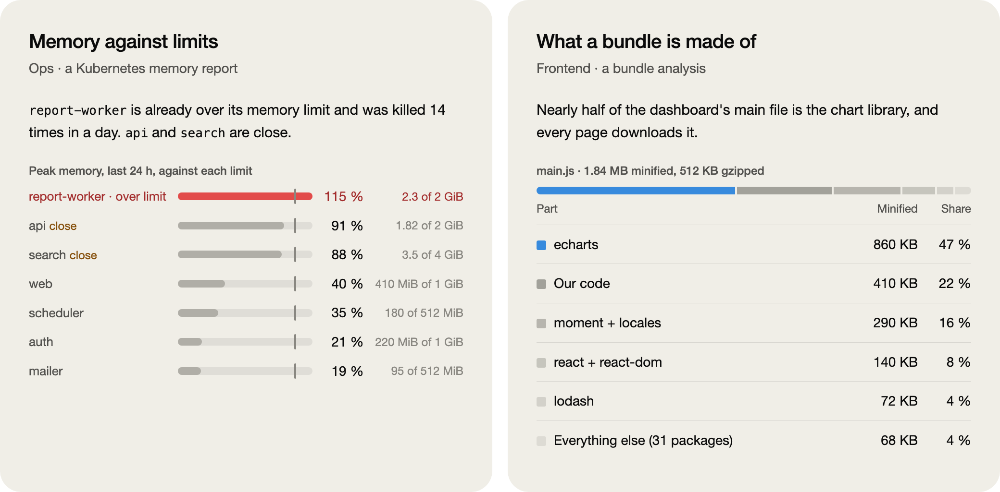
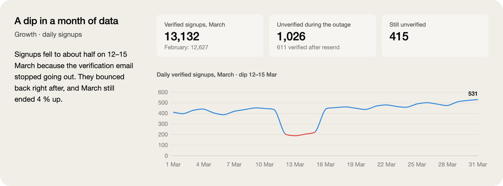
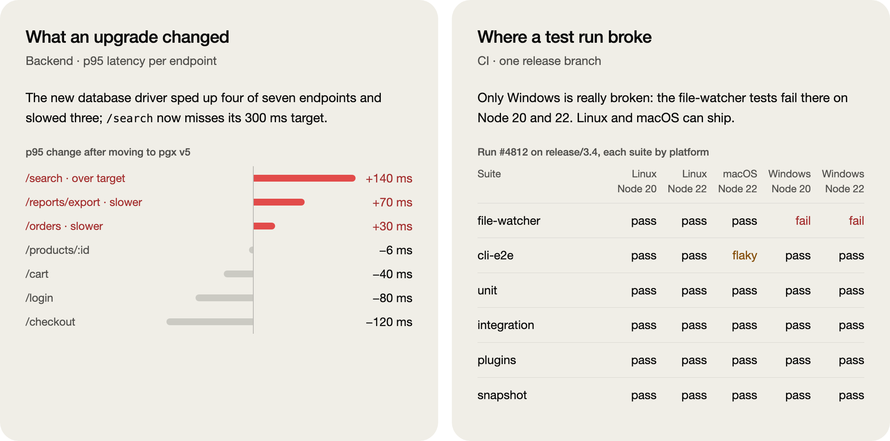
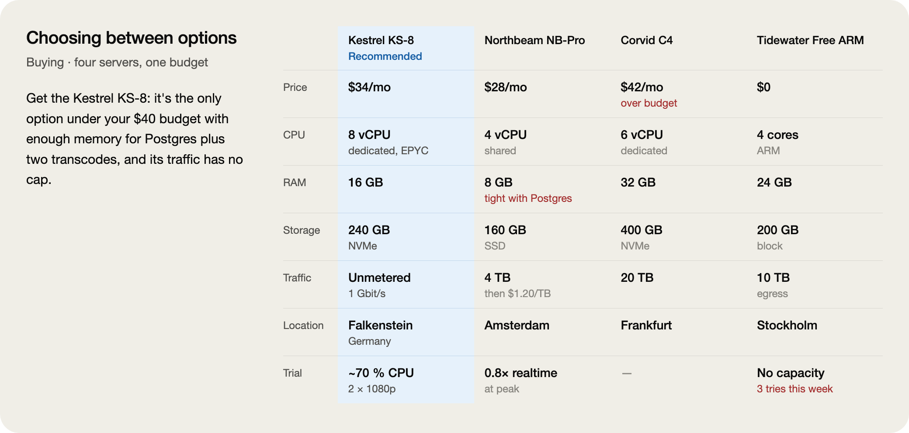
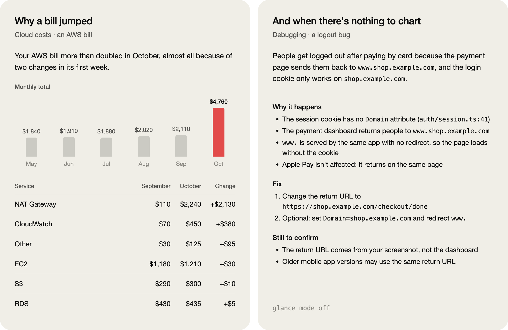

<picture>
  <source media="(prefers-color-scheme: dark)" srcset="docs/images/hero-dark.png">
  
</picture>

# glance

**Claude's long answers, readable at a glance.** Type `/glance` after any answer and get it back as one plain sentence, a picture of the data and a few short bullets. Every number, name, path, command, warning and open question stays in.

```bash
git clone https://github.com/haslanli/glance-skill ~/.claude/skills/glance
```

Claude Code picks up new skills while it runs, so there's no restart. If `~/.claude/skills` didn't exist before, run `/reload-skills` once. To update later, run `git -C ~/.claude/skills/glance pull`.

## A picture for every kind of answer

glance reads the answer before it draws. It picks the form that fits the data: meters when values have limits, a split bar when one total breaks into parts, bars that go both ways when some things got better and some got worse, a line for a long series, a grid for a test matrix, a comparison when you're choosing. When an answer is mostly reasoning, it draws nothing.

<picture>
  <source media="(prefers-color-scheme: dark)" srcset="docs/images/gallery-ops-dark.png">
  
</picture>

<picture>
  <source media="(prefers-color-scheme: dark)" srcset="docs/images/gallery-growth-dark.png">
  
</picture>

<picture>
  <source media="(prefers-color-scheme: dark)" srcset="docs/images/gallery-eng-dark.png">
  
</picture>

<picture>
  <source media="(prefers-color-scheme: dark)" srcset="docs/images/gallery-choice-dark.png">
  
</picture>

<picture>
  <source media="(prefers-color-scheme: dark)" srcset="docs/images/gallery-money-dark.png">
  
</picture>

## Readable by everyone

About one man in twelve can't easily tell red from green. Most charts lean on exactly that pair, so glance is built to work without it.

<picture>
  <source media="(prefers-color-scheme: dark)" srcset="docs/images/color-dark.png">
  
</picture>

- **Red never sits against green.** An improvement stays gray instead of turning green. Only what's worse, over a limit or failing turns red, and only the item the answer is about turns blue. Blue and red stay far apart for everyone.
- **There is no amber warning color.** v2 tried one for "tight" meters, and a color validator rejected it. Under red-green color blindness, amber and the alert red differ by only 3.2, where 8 is the minimum. Even with full color vision they score 12.7, below the floor of 15. So "tight" and "close" are words, and the bar stays gray.
- **Every colored mark also carries a word**: "over limit", "slower", "fail", "Recommended". Color helps you find it, and the word tells you what it means, so nothing depends on color alone.
- **Every value is printed** on the picture, so nothing hides behind a hover. Line charts add a hover readout on top of that.
- **Each picture opens with a one-sentence summary** for screen readers. Its colors come from the app's theme, so light and dark mode both work. Comparisons turn into cards in narrow side panels.

## It keeps every fact

- Every number, name, path, command, step, warning and open question from the original stays in.
- It adds nothing the original didn't say: no trend lines, averages or projections. A value it doesn't have is shown as `—`.
- Commands, code and error messages stay word for word.
- Charts are honest: bars and lines start at zero, and things compared share one scale and one unit. There's never a second y-axis.

## Commands

After a long answer, type `/glance`. To keep the result out of the main conversation, ask it as a side question: `/btw /glance`.

| Command | What it does |
|---|---|
| `/glance` | Re-tells the last answer once |
| `/glance <what>` | Re-tells one answer or part of one: `your reply about the build`, `only the numbers`, or pasted text |
| `/glance on` | Re-tells the last answer, then answers this way until you turn it off |
| `/glance super` | Same as `on`, with every bullet cut to a short fragment |
| `/glance off` | Back to normal replies |
| `/glance status` | Says which mode is on |
| `/glance help` | Shows this list |

Modes set inside `/btw` stay there. A side question doesn't change the main conversation.

## New in v2

- **Meters** show values against their limits, and a service over its limit visibly runs past the limit mark.
- **A split bar** shows how one total breaks into parts.
- **Bars that go both ways** show changes where some things got better and some got worse.
- **Status grids** cover test matrices, with the failure marked in its own cell.
- **Line charts** start at zero, mark the stretch the answer is about in red, and show a readout on hover.
- **Accessible colors** checked with a validator, a word on every colored mark, and a summary for screen readers.
- **Thinner bars and stronger values**, following the design rules of Claude's dataviz skill.

## Where the pictures show up

Pictures are drawn with the visualize tool in the Claude desktop app, including `/btw` side chats there. Where that tool isn't available, for example `/btw` in a terminal, glance falls back to markdown tables that follow the same rules.

## Tested on real answers

`evals/` holds ten reports glance is tested against: a cloud bill, a server choice, a site speed pass, memory limits, a latency change, a month of signups, a bundle breakdown, a weather analysis, a CI matrix and a bug explanation that shouldn't get a picture. Each case comes with pass/fail checks, and scripts in `tools/` check kept numbers and length. Before release, v2 ran against v1 on all ten cases in two rounds, each judged blind. Across all 41 runs of both versions, 38 kept every number; the other three dropped only the "78" from a "78 years" heading and kept "1948–2025".

The cases use the folder format that `claude plugin eval` reads:

```bash
claude plugin eval . --allow-tools Write,Edit,Bash --scaffold
```

## What's in this repo

| Path | Contents |
|---|---|
| `SKILL.md` | The instructions Claude follows |
| `references/ui-kit.md` | The CSS and components every picture is built from |
| `evals/` | Ten test reports with pass/fail checks |
| `tools/` | Scripts that check numbers and length, a renderer for any widget, and the builder for these images (`python3 tools/preview/build.py --png`) |

## Credits

glance started from [tldr](https://github.com/generativelabs/g-genlabs-skill-tldr) by [Generative Labs](https://www.generativelabs.com). Pointing at an earlier answer, the on/super/off modes and the rule to cut wording but keep every fact all come from tldr. glance adds the plain-language first line, the pictures and the UI kit. v2's chart rules and color checks follow Claude's dataviz skill. If you only want bullet summaries, tldr does that well.

## License

MIT. See [LICENSE](LICENSE).
